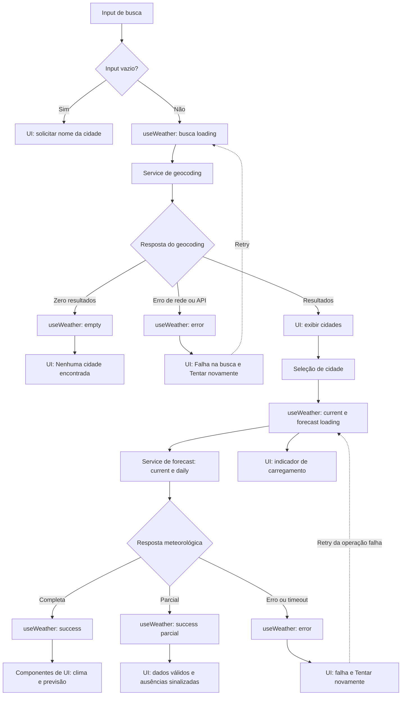

## Architecture

Aplicação web client-side, sem autenticação e sem persistência no servidor. A arquitetura mantém a rede isolada nos serviços e a normalização em funções puras.

```text
React UI (components)
        |
        v
Hook de orquestração (useWeather)
        |                     \
        v                      v
Serviço de geocoding     Serviço de forecast
        |                      |
        +----------+-----------+
                   v
       Open-Meteo Geocoding + Forecast

Respostas externas -> normalizadores puros (lib) -> contratos de domínio (types)
```

- **UI (`components/`, `App.tsx`)**: captura busca e seleção, apresenta resultados e estados; não conhece URLs nem payloads do provedor.
- **Orquestração (`hooks/`)**: coordena busca, seleção, carregamento, retry e identidade da consulta vigente. Mantém separados o resultado atual e a previsão.
- **Acesso externo (`services/`)**: constrói requisições Open-Meteo, interpreta status HTTP e entrega payloads tipados como desconhecidos para validação/normalização. Nenhum componente chama a API diretamente.
- **Funções puras (`lib/`)**: validam e convertem respostas do provedor em contratos de domínio; conversão de temperatura para apresentação também fica isolada e não causa nova requisição.
- **Contratos (`types/`)**: modelos compartilhados de cidade, clima, estado e erro.

Não há backend próprio no MVP. As fronteiras permitem testar a UI e os serviços com respostas controladas, sem depender de chamadas ao vivo.

## Tech Stack

| Tecnologia | Decisão e justificativa | Rastreabilidade |
| --- | --- | --- |
| React + TypeScript strict | Mantém a stack do repositório; contratos discriminados representam estados sem `any`. | FR-01–FR-08; AC-01–AC-08; NFR-06 |
| Vite | Ferramenta de desenvolvimento e build já adotada pelo projeto. | NFR-04, NFR-07 |
| Tailwind CSS | Mantém o padrão visual e de estilo do repositório. | NFR-01, NFR-03 |
| pnpm + Biome | Mantêm os comandos e convenções de dependências, lint e formatação existentes. | NFR-07 |
| Vitest + Testing Library | Testes rápidos de funções, serviços e componentes React. | AC-01–AC-08; NFR-03, NFR-04 |
| Playwright | Validação dos fluxos integrados em navegador, com APIs interceptadas. | AC-01–AC-08; NFR-01, NFR-03, NFR-07 |
| Open-Meteo | Fonte inicial confirmada, sem API key. Termos, cobertura, limites e disponibilidade precisam ser avaliados; não se presume precisão ou garantia do provedor. | FR-01–FR-04, FR-07; NFR-05, NFR-08 |

Não se propõe Redux, TanStack Query, persistência de browser ou uma camada de backend: o estado e o fluxo atuais não justificam essas dependências.

## Project Structure

Preservar a organização do README; responsabilidades previstas, sem criar arquivos nesta etapa:

```text
src/
├── components/      # Busca, resultados, cidade selecionada e seções meteorológicas
│   └── states/      # Apresentações reutilizáveis de loading, erro e vazio
├── hooks/           # useWeather: estado e orquestração da tela
├── services/        # Cliente Open-Meteo, geocoding e forecast
├── lib/             # Normalização, validação, conversão e formatação puras
├── types/           # Contratos compartilhados
├── styles/          # Tailwind e estilos globais
├── App.tsx          # Composição da experiência
└── main.tsx         # Bootstrap React
```

Manter um componente por arquivo, serviços sem dependência da UI e funções puras testáveis. Os nomes são responsabilidades planejadas, não instrução para gerar arquivos agora.

## Data Model

Contratos declarativos; campos externos não validados não devem ser tratados como domínio. `null` representa um campo selecionado para exibição, mas ausente ou inválido na resposta. A spec exige temperatura atual; os demais campos e a granularidade da previsão abaixo são uma proposta técnica baseada em variáveis disponíveis na Open-Meteo e precisam ser aprovados.

```ts
type Unit = "celsius" | "fahrenheit";

interface City {
  id?: number; // ID da localidade, quando fornecido.
  name: string; // Nome da cidade retornado pelo geocoding.
  latitude: number; // Latitude usada na consulta meteorológica.
  longitude: number; // Longitude usada na consulta meteorológica.
  country?: string; // País, quando disponível.
  countryCode?: string; // Código do país, quando disponível.
  admin1?: string; // Região administrativa, quando disponível.
  timezone?: string; // Fuso IANA, quando disponível.
}

interface CurrentWeather {
  time: string; // Horário local da observação retornado pela API.
  temperatureC: number | null; // Temperatura atual em Celsius.
  apparentTemperatureC: number | null; // Sensação térmica em Celsius, proposta.
  relativeHumidityPct: number | null; // Umidade relativa em porcentagem, proposta.
  precipitationMm: number | null; // Precipitação atual em milímetros, proposta.
  windSpeedKmh: number | null; // Velocidade do vento em km/h, proposta.
  weatherCode: number | null; // Código meteorológico WMO, proposta.
  isDay: boolean | null; // Indicador de dia/noite, proposta.
}

interface ForecastDay {
  date: string; // Data local no formato YYYY-MM-DD.
  temperatureMinC: number | null; // Mínima diária em Celsius, proposta.
  temperatureMaxC: number | null; // Máxima diária em Celsius, proposta.
  precipitationProbabilityMaxPct: number | null; // Probabilidade máxima de precipitação, proposta.
  precipitationSumMm: number | null; // Precipitação diária em milímetros, proposta.
  windSpeedMaxKmh: number | null; // Velocidade máxima diária do vento em km/h, proposta.
  weatherCode: number | null; // Código meteorológico WMO do dia, proposta.
}

interface WeatherData {
  city: City; // Localidade à qual os dados pertencem.
  current: CurrentWeather; // Dados atuais normalizados.
  forecast: readonly ForecastDay[]; // Até cinco datas locais normalizadas.
  retrievedAt: string; // Instante da consulta em ISO 8601.
}

type WeatherError =
  | { kind: "network" }
  | { kind: "http"; status: number }
  | { kind: "rate-limited" }
  | { kind: "timeout" }
  | { kind: "invalid-payload" }
  | { kind: "weather-unavailable" };

type ResourceState<T> =
  | { status: "idle" }
  | { status: "loading" }
  | { status: "success"; data: T }
  | { status: "error"; error: WeatherError };

type CitySearchState =
  | { status: "idle" }
  | { status: "loading" }
  | { status: "empty" }
  | { status: "success"; cities: readonly City[] }
  | { status: "error"; error: WeatherError };

interface WeatherViewState {
  selectedCity: City | null;
  unit: Unit;
  current: ResourceState<CurrentWeather>;
  forecast: ResourceState<readonly ForecastDay[]>;
}
```

- `Unit` representa a preferência de apresentação; a temperatura permanece em Celsius no domínio. Ao converter para Fahrenheit, não se altera o dado armazenado nem se faz nova busca.
- `temperatureC` é exigido por FR-03. Os demais campos de `CurrentWeather` e `ForecastDay` são uma proposta inicial para produto; selecionar campos da Open-Meteo não aprova automaticamente sua exibição no MVP.
- Campos escolhidos, mas ausentes ou inválidos na resposta, normalizam para `null`; não usar `undefined`, zero ou valores de consultas anteriores como substitutos.
- `weatherCode` preserva o código WMO fornecido pela API; a tabela de rótulos/ícones em pt-BR precisa ser definida e testada antes da apresentação visual.
- `City.id` pode não existir no retorno; seleção deve preservar coordenadas e contexto retornados. `timezone`, `country` e `admin1` são opcionais porque o provedor pode não os retornar.
- `WeatherData` agrega cidade, dados atuais, previsão e instante da consulta; no estado de tela, `current` e `forecast` permanecem independentes para permitir sucesso parcial sem apresentar conteúdo antigo como atual.
- Uma busca sem resultados é `empty`, não `WeatherError`. O valor inicial de `unit` é `"celsius"`.

## Data Flow



1. A pessoa informa o nome da cidade. Antes de enviar, o hook remove somente espaços externos (`trim`); busca vazia não chama serviço. Preserva Unicode, acentos, apóstrofos, pontuação e espaços internos.
2. O hook define a busca como loading e chama o serviço de geocoding com o texto aparado. Resultado vazio encerra em `empty`, sem solicitar forecast.
3. A UI apresenta nome e, quando disponíveis, região administrativa e país. A seleção identifica uma cidade concreta, incluindo coordenadas e metadados retornados.
4. Ao selecionar uma cidade, a orquestração inicia as consultas de clima atual e forecast. Cada serviço valida/normaliza a resposta através de funções puras, que convertem dados para Celsius e datas locais no timezone retornado/configurado.
5. O hook publica os resultados da cidade ainda vigente em estados independentes. Respostas associadas a uma busca/seleção anterior são ignoradas.
6. A UI apresenta apenas campos válidos, marca ausências com `Indisponível` e limita a previsão às datas efetivamente válidas recebidas, sem preencher lacunas.
7. A troca entre °C e °F recalcula os valores de exibição a partir dos valores em Celsius mantidos no domínio; não repete geocoding nem forecast.
8. Retry é ação explícita e repete somente a operação que falhou, com a busca/cidade correspondente.

**Política de busca:** remover espaços externos e preservar Unicode é confirmado por AC-01b/AC-01c. Normalização sem distinção de acentos é uma alternativa ainda não aprovada; até decisão, não remover diacríticos nem transliterar. `locale` e `count` do endpoint permanecem pendentes. Não incluir autocomplete, busca enquanto digita ou persistência.

## External APIs

### Confirmado pela spec

- Open-Meteo como fonte inicial, sem API key.
- Busca de localidade por nome; clima atual; previsão para hoje e os quatro dias seguintes, segundo as datas locais do timezone da cidade.
- A spec não fecha campos meteorológicos, granularidade diária/horária, `locale` da busca ou `count` de resultados.

### Contratos técnicos propostos, sujeitos à aprovação

### Geocoding

- **URL:** `https://geocoding-api.open-meteo.com/v1/search`
- **Parâmetros:** `name` é obrigatório e recebe a cidade após `trim` e codificação de URL. `count=10`, `language=pt` e `format=json` são valores propostos; quantidade e idioma ainda não foram aprovados. Não enviar requisição para input vazio.
- **Exemplo resumido de resposta:**

```json
{
  "results": [
    {
      "id": 3448439,
      "name": "São Paulo",
      "latitude": -23.5475,
      "longitude": -46.6361,
      "country": "Brazil",
      "country_code": "BR",
      "admin1": "São Paulo",
      "timezone": "America/Sao_Paulo"
    }
  ]
}
```

- **Mapeamento para `City`:** `id` → `id`; `name` → `name`; `latitude`/`longitude` → coordenadas; `country` → `country`; `country_code` → `countryCode`; `admin1` → `admin1`; `timezone` → `timezone`. Campos de contexto ausentes permanecem opcionais. Resposta válida sem resultados (`results` vazio ou ausente) vira estado `empty`; JSON malformado ou falha HTTP é erro de geocodificação, não busca vazia.

### Forecast

- **URL:** `https://api.open-meteo.com/v1/forecast`
- **Parâmetros comuns:** `latitude` e `longitude` vêm do `City` selecionado; `timezone` usa o fuso IANA retornado pelo geocoding; `temperature_unit=celsius`; `wind_speed_unit=kmh`; `forecast_days=5`.
- **`current` proposto:** `temperature_2m,apparent_temperature,relative_humidity_2m,precipitation,wind_speed_10m,weather_code,is_day`.
- **`daily` proposto:** `temperature_2m_min,temperature_2m_max,precipitation_probability_max,precipitation_sum,wind_speed_10m_max,weather_code`. `daily` é a proposta mais simples para `ForecastDay`; se a spec aprovar previsão horária, os parâmetros e o modelo deverão ser revistos.
- **Exemplo resumido de resposta:** o trecho mostra duas posições para abreviar; a chamada com `forecast_days=5` deve retornar cinco posições em cada série diária.

```json
{
  "timezone": "America/Sao_Paulo",
  "current": {
    "time": "2026-10-27T09:00",
    "temperature_2m": 18.4,
    "apparent_temperature": 19.1,
    "relative_humidity_2m": 68,
    "precipitation": 0.0,
    "wind_speed_10m": 12.3,
    "weather_code": 1,
    "is_day": 1
  },
  "daily": {
    "time": ["2026-10-27", "2026-10-28"],
    "temperature_2m_min": [16.2, 17.0],
    "temperature_2m_max": [24.5, 25.1],
    "precipitation_probability_max": [10, 20],
    "precipitation_sum": [0.0, 1.2],
    "wind_speed_10m_max": [18.0, 20.5],
    "weather_code": [1, 3]
  }
}
```

- **Mapeamento para `CurrentWeather`:** `current.time` → `time`; `temperature_2m` → `temperatureC`; `apparent_temperature` → `apparentTemperatureC`; `relative_humidity_2m` → `relativeHumidityPct`; `precipitation` → `precipitationMm`; `wind_speed_10m` → `windSpeedKmh`; `weather_code` → `weatherCode`; `is_day` (0/1) → `isDay` (boolean).
- **Mapeamento para `ForecastDay`:** para cada índice `i`, `daily.time[i]` → `date`; `temperature_2m_min[i]` → `temperatureMinC`; `temperature_2m_max[i]` → `temperatureMaxC`; `precipitation_probability_max[i]` → `precipitationProbabilityMaxPct`; `precipitation_sum[i]` → `precipitationSumMm`; `wind_speed_10m_max[i]` → `windSpeedMaxKmh`; `weather_code[i]` → `weatherCode`.
- **Composição de `WeatherData`:** agregar o `City` selecionado, o objeto normalizado `CurrentWeather`, os `ForecastDay[]` válidos e `retrievedAt` gerado pelo cliente no instante da obtenção. `Unit` é preferência de apresentação e não altera as temperaturas Celsius armazenadas.
- Verificar `current_units` e `daily_units` da resposta para validar unidades. Variável escolhida ausente/inválida vira `null`; data sem previsão não é inventada. Configurar explicitamente timezone local da cidade e Celsius é proposta técnica; fallback de timezone ausente ainda precisa de decisão.

- `forecast_days=5` é a configuração proposta para as cinco datas exigidas; os limites e a forma de representar datas devem ser conferidos contra o contrato vigente do endpoint antes da implementação.
- A lista de campos da linha Forecast é uma proposta inicial coerente com os contratos apresentados. Aprovar ou ajustar campos e granularidade (`daily` ou `hourly`) antes da implementação; se forem escolhidos dados horários, revisar `ForecastDay` para representar períodos horários. `count`, idioma de geocoding e política de correspondência sem acentos também permanecem pendentes.
- Os serviços devem codificar a query preservando caracteres Unicode, verificar status HTTP e tratar resposta como não confiável até normalização. Não se presume precisão, disponibilidade ou garantia de dados do provedor.
- Validar antes da implementação termos de uso, limites, cobertura, disponibilidade e custos aplicáveis (NFR-05, NFR-08).

## State Management

- **Localização do estado:** o texto editável da busca vive no componente `CitySearch`. `useWeather` é fonte única de estado para resultados da busca, cidade selecionada, estados/erros de current e forecast e unidade atual. Componentes recebem dados e callbacks; não mantêm cópias divergentes dos dados meteorológicos. Não há estado global, storage de browser ou persistência no servidor.
- **Estados explícitos:** `CitySearchState` usa `idle`, `loading`, `success`, `empty` e `error`; `empty` significa somente geocoding bem-sucedido sem resultados. `ResourceState<T>` para clima atual e previsão usa `idle`, `loading`, `success` e `error`. Em `success`, campos `null` representam dados parciais; datas válidas da previsão são preservadas, e a UI deriva o rótulo de incompletude. Se não existir nenhum dado utilizável para uma seção, ela termina em `error` com `weather-unavailable`.
- **Unidade e conversão:** `unit` começa em `celsius` e vive somente na sessão da tela. Current e forecast mantêm temperaturas em Celsius. Na renderização, converter cada campo de temperatura aprovado usando $F = C \times 9/5 + 32$ quando `unit === "fahrenheit"`; exibir °C caso contrário. A troca da unidade atualiza somente a apresentação, sem chamar geocoding ou forecast e sem alterar os valores armazenados. A regra de arredondamento depende da decisão de produto.
- **Concorrência:** associar cada operação a uma identidade crescente de busca/seleção. Antes de publicar resultado ou erro, verificar se corresponde à identidade vigente e ignorar respostas tardias. `AbortController` pode cancelar trabalho desnecessário, mas não substitui essa verificação.
- **Retry:** ação explícita do usuário, limitada à operação que falhou e aos parâmetros correntes. Sem retry automático, cache ou persistência no MVP.
- **Troca de cidade:** ao selecionar outra cidade, associar novo estado à seleção imediatamente e não manter dados da anterior como atuais. Se current ou forecast falhar, preservar somente a seção independente que terminou com sucesso para a cidade atual.

## Error Handling

| Situação | Comportamento e mensagem literal | Rastreabilidade |
| --- | --- | --- |
| Campo vazio ou só espaços | Não requisitar, não iniciar loading; exibir `Informe uma cidade para buscar`. | AC-01b |
| Geocoding conclui sem resultados | Estado vazio, sem chamada meteorológica; exibir `Nenhuma cidade encontrada`. Não é erro do serviço. | AC-07a |
| Falha de rede em qualquer endpoint | Finalizar o loading daquela operação; geocoding exibe `Falha na busca`, forecast/current exibe `Não foi possível obter os dados`; oferecer `Tentar novamente`. | AC-07b, AC-07c |
| HTTP 429 (limite do provedor) | Classificar como `rate-limited`, finalizar loading e exibir a mensagem correspondente ao endpoint; permitir retry explícito, sem retry automático. | AC-07b, AC-07c |
| HTTP diferente de 2xx, incluindo 4xx/5xx, ou payload/JSON inválido | Classificar como erro HTTP ou `invalid-payload`, não como busca vazia; finalizar loading, usar mensagem correspondente ao endpoint e oferecer retry. | AC-07b, AC-07c |
| Requisição pendente por 8 segundos | Abortar a requisição, finalizar loading, exibir `A consulta demorou demais`, oferecer `Tentar novamente` e ignorar eventual resposta tardia. Os 8 segundos continuam provisórios até confirmação na spec. | AC-07d; questão aberta na spec |
| Forecast com menos de cinco datas válidas | Exibir somente datas recebidas e `Previsão incompleta`; sem data válida, `Previsão indisponível`. Não inventar datas/valores. | AC-04b |
| Campo meteorológico individual ausente/inválido | Normalizar o campo selecionado para `null`, exibir `Indisponível` nele e preservar os demais campos válidos; não reutilizar valores anteriores. | AC-03b, AC-03c |
| Resposta parcial | Manter a seção em sucesso parcial se houver dado utilizável: current exige ao menos um campo válido; forecast mostra datas válidas e `Previsão incompleta`. Sem dados utilizáveis, terminar a seção em `weather-unavailable`. Current e forecast têm estados independentes. | AC-03b, AC-03c, AC-04b |
| Resposta de cidade anterior chega depois da seleção atual | Ignorar resposta; não atualizar identificação nem seções da cidade vigente. | AC-06b |

`empty` é um resultado válido somente para geocoding sem hits; falhas de transporte, status HTTP não bem-sucedido e payload inválido permanecem estados `error`. Mensagens de UI são distintas por operação e não devem revelar detalhes internos da resposta externa. Não há retry automático.

**Ponto de consistência a resolver:** AC-07d exige timeout aos 8 segundos, enquanto a seção Open Questions o chama de provisório e pede confirmação entre 5, 8 ou 10 segundos. Implementação deve aguardar decisão de produto ou tratar 8 segundos como requisito provisório explicitamente aceito; este plano não altera o critério.

## Testing Strategy

Todos os testes usam fixtures de payloads Open-Meteo e relógio controlado; nenhuma suíte depende de API ao vivo. E2E deve interceptar as rotas externas. Os testes devem ser derivados dos critérios de aceite, não gerar escopo de produto novo.

| Camada | Cobertura prevista | ACs / NFRs |
| --- | --- | --- |
| Vitest — funções puras | Aparar espaços externos preservando Unicode; converter C→F→C sem mutar o valor canônico; preservar `null`; mapear respostas válidas/parciais; converter `is_day`; gerar cinco datas no timezone de teste; rejeitar payloads malformados. | AC-01b, AC-01c, AC-03b, AC-03c, AC-04, AC-04b, AC-05; NFR-06 |
| Vitest — services com `fetch` mockado | Verificar URL, query params e mapeamentos; sucesso geocoding/forecast; zero hits; HTTP 429/5xx; outros não-2xx; falha de rede, JSON inválido, timeout e payload parcial. Garantir que busca vazia não chama geocoding e zero hits não chama forecast. | AC-01, AC-01b, AC-02, AC-03b, AC-04b, AC-07a–AC-07d; NFR-04, NFR-08 |
| Vitest + Testing Library — componentes | Renderizar e interagir com `CitySearch`, resultados, unidades, clima e previsão. Cobrir estado inicial/idle, loading, success, empty e error; retry; mensagens literais; `Indisponível`; previsão incompleta; teclado e nomes acessíveis. Trocar unidade não pode provocar nova chamada. | AC-01–AC-08; NFR-02, NFR-03 |
| Vitest — integração do hook | Transições entre estados; current e forecast independentes; seleção de cidade; retry apenas da operação falha; timeout; corrida A/B em que resposta tardia de A não substitui B; alternância de unidade sem nova chamada. Usar promises controladas e relógio falso. | AC-05, AC-06, AC-06b, AC-07b–AC-08; NFR-06 |
| Playwright — E2E desktop | Fluxo completo busca → seleciona cidade → consulta clima e cinco datas → alterna unidade; também input vazio, zero hits, erros, retry e loading. Interceptar todas as rotas Open-Meteo com fixtures; não acessar API real. | AC-01–AC-08; NFR-02, NFR-03, NFR-07 |
| Playwright — E2E mobile | Repetir o fluxo principal em viewports móveis propostos de 320 px e 375 px; verificar controles alcançáveis, conteúdo sem sobreposição/rolagem horizontal e fluxo de erro. Confirmar dispositivos e viewports finais com a matriz de compatibilidade. | AC-01–AC-08; NFR-01, NFR-03, NFR-07 |

Fixar a data do relógio e o timezone da cidade para verificar exatamente cinco datas locais, sem sexta data. Testes com mocks validam lógica e UI, mas não demonstram desempenho nem disponibilidade reais do provedor; medir NFR-04/NFR-05 em ambiente e perfil de rede acordados, separadamente da suíte determinística. A matriz de viewports/navegadores e a aprovação de metas continuam pendentes na spec.

## Risks & Trade-offs

- **Bloqueios de produto:** fields do clima atual/previsão, granularidade, política de busca por acentos, `count`/locale, fallback de timezone, validade/atualização e formatação de datas/hora precisam de decisão antes de fechar contrato de UI e critérios de aceite. Sem isso, implementação e aceite de cobertura meteorológica ficam bloqueados ou limitados à temperatura mínima confirmada (FR-03).
- **Timeout contraditório em status:** 8 segundos é critério observável em AC-07d, mas continua como proposta nas perguntas abertas. Resolver com responsável de produto antes de tratar a duração como compromisso final.
- **Dados incompletos:** representar ausência evita inventar valores, mas a escolha de quais campos são essenciais determina se current é utilizável e como se interpreta resposta parcial. Definir regras depois de aprovar a lista de campos.
- **Timezone ausente:** configurar explicitamente o timezone da cidade atende à semântica de cinco datas locais; a spec não define fallback para geocoding sem timezone. Não usar timezone do dispositivo silenciosamente, pois isso pode deslocar a data (AC-04, NFR-06).
- **Geocoding homônimo e unicode:** nomes iguais exigem contexto retornado e coordenadas corretas. A spec confirma preservação de acentos no envio, mas não confirma busca sem distinção de acentos, aliases ou transliteração.
- **Dependência externa:** latência, falhas, limites, cobertura, termos e custos dependem do Open-Meteo; não prometer precisão nem disponibilidade. Definir monitoramento e interpretar NFR-05 sem atribuir indisponibilidade externa à aplicação.
- **Unidades e campos abertos:** Celsius no domínio evita perda por alternância, mas somente temperaturas aprovadas devem ser convertidas. Definir campos e arredondamento antes do aceite visual (AC-05).
- **Metas não aprovadas:** NFR-01 a NFR-08 incluem metas iniciais a validar (dispositivos, usabilidade, WCAG, performance, disponibilidade, atualidade, navegadores e requisitos corporativos). Registrar método e responsável antes de declarar conformidade.
- **Questões de consistência na spec:** (1) AC-07d fixa 8s enquanto Open Questions solicita confirmação; resolução proposta: aprovação explícita do timeout sem editar a spec neste plano. (2) AC-03c exige temperatura `Indisponível` e mantém outros campos válidos, enquanto Edge Cases adiciona `Dados atuais indisponíveis` se nenhum campo atual for válido; resolução proposta: manter a temperatura como `Indisponível` em ambos os casos e usar a mensagem de seção somente quando nenhum campo puder ser apresentado. Validar o texto/condição com produto.
- **Escopo fechado:** não reabrir autenticação, persistência no servidor, GPS/localização automática, offline/cache, app nativo, alertas, favorites, history, share ou notifications. Qualquer inclusão exige mudança aprovada de escopo e revisão de privacidade/segurança; não faz parte deste plano.

### Trade-offs técnicos

| Decisão do plano | Alternativa considerada | Trade-off |
| --- | --- | --- |
| Estado local em hooks React | Redux ou TanStack Query | Menos dependências e conceitos para o MVP; exige implementar manualmente estados de requisição, retry e proteção contra respostas fora de ordem. |
| Celsius como unidade canônica; conversão derivada na renderização | Solicitar novamente à API ao trocar unidade ou armazenar valores em unidades mistas | Evita rede e divergência entre current/forecast; exige definir precisão de exibição e incluir cada novo campo de temperatura na conversão. |
| Sem backend, autenticação ou persistência | Serviço próprio com contas e dados salvos | Menor custo e superfície de privacidade; sem histórico, favoritos ou sincronização entre dispositivos no MVP. |
| Sem cache/offline; retry explícito | Cache stale-while-revalidate, retry automático ou suporte offline | Evita apresentar previsão antiga como atual e simplifica estados; durante falhas de rede, a pessoa não recebe dados previamente carregados. |
| Serviços Open-Meteo separados dos componentes, com normalizadores puros | Chamada `fetch` direta nos componentes ou acesso ao payload externo em toda a UI | Facilita mock, testes e eventual troca do provedor; requer mapeamento explícito entre DTO externo e modelo de domínio. |
| Forecast diário como proposta inicial | Forecast horário | Modelo e interface mais simples para cinco datas; horário dá mais detalhe, mas aumenta volume, decisões de fuso e complexidade de apresentação/teste. A granularidade final continua pendente. |
| Vitest com fixtures e Playwright interceptando a rede | Testes E2E dependentes da API ao vivo | Execução determinística, rápida e sem limites externos; não detecta sozinho mudanças reais do contrato do provedor nem comprova latência/disponibilidade. |

| Decisão/contrato | IDs rastreados |
| --- | --- |
| Busca aparada, Unicode preservado, vazio sem rede, zero hits distinto de falha | FR-01, FR-07; AC-01, AC-01b, AC-01c, AC-07a, AC-07c |
| Seleção contextual por cidade e isolamento de resultados entre cidades | FR-02, FR-06; AC-02, AC-06, AC-06b; NFR-06 |
| Domínio em Celsius, unidade de apresentação separada | FR-03, FR-05; AC-03, AC-05; NFR-06 |
| Cinco datas locais; granularidade/fields aguardam decisão | FR-04; AC-04, AC-04b; NFR-06 |
| Loading, erro, vazio e retry explícitos | FR-07, FR-08; AC-01b, AC-07a–AC-08; NFR-03 |
| Respostas tardias não alteram a seleção vigente | FR-06, FR-07; AC-06b, AC-07d; NFR-06 |
| API sem chave, integração isolada e comunicação HTTPS | FR-01–FR-04; NFR-05, NFR-08 |
| Layout responsivo, teclado/nome acessível e testes de navegador | FR-01–FR-08; NFR-01, NFR-02, NFR-03, NFR-07 |
| Timeout inicial de 8s e configuração explícita de timezone/Celsius | FR-04, FR-07; AC-04, AC-07d; NFR-04, NFR-06 (propostas pendentes de confirmação) |